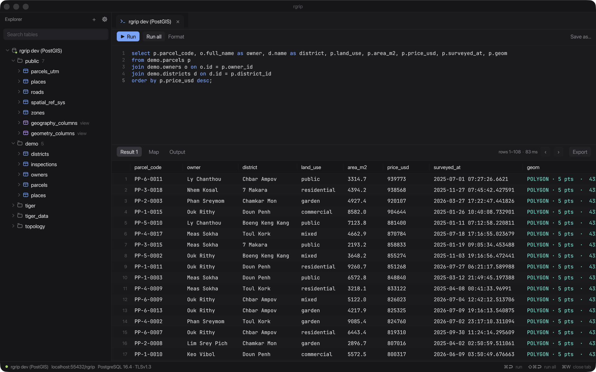
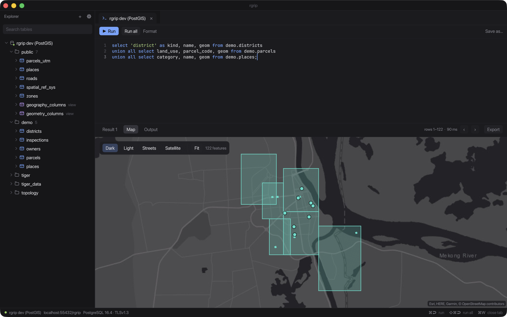
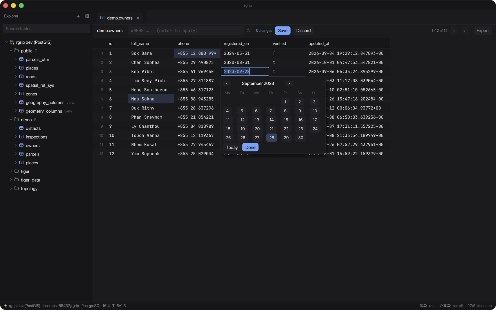
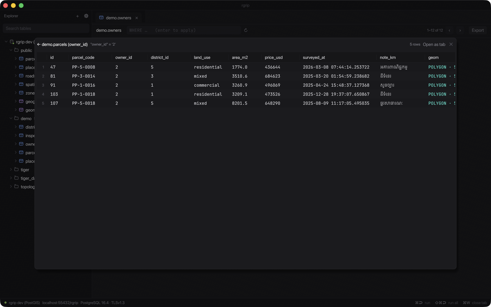
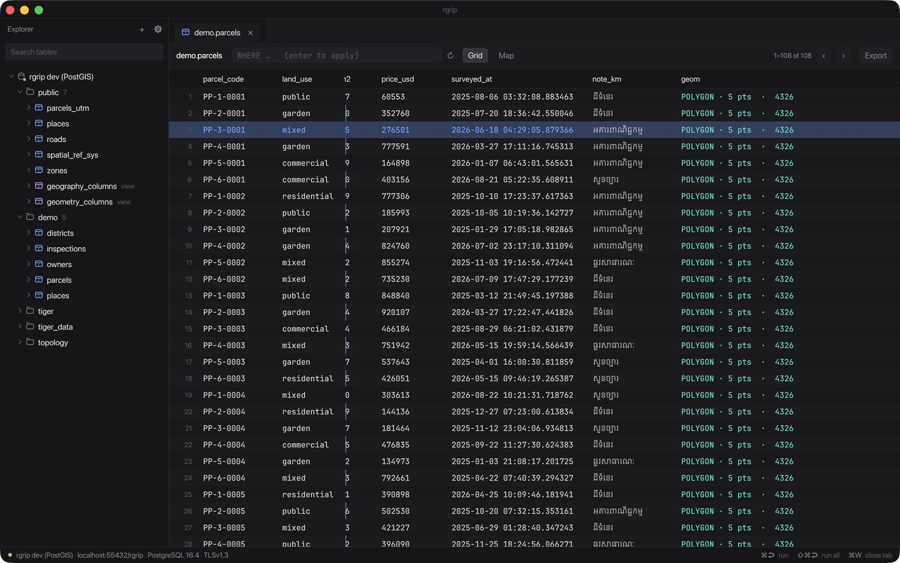
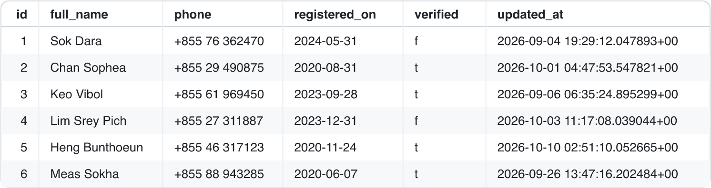
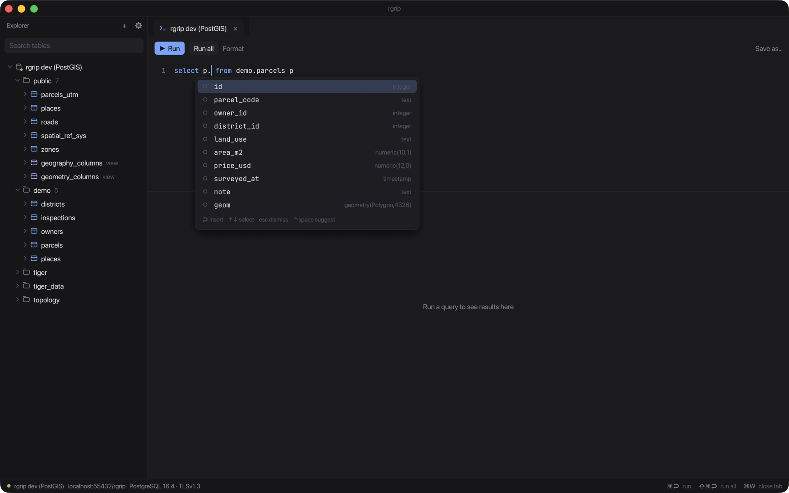

<p align="center"></p>

<h1 align="center">rgrip</h1>

<p align="center"><b>PostGIS, without opening QGIS.</b><br>A tiny native PostgreSQL client in Rust that puts any query's geometry on a map.</p>

<p align="center">
  <a href="https://github.com/yoouTaro/rgrip/releases"></a>
  
  
  
  
  <a href="https://github.com/sponsors/yoouTaro"></a>
</p>

<p align="center">
  <a href="https://yoouTaro.github.io/rgrip/">Website</a> ·
  <a href="https://github.com/yoouTaro/rgrip/releases">Download</a> ·
  <a href="CHANGELOG.md">Changelog</a>
</p>

<p align="center"></p>

## Why rgrip

- **Tiny and native.** A 9 MB download, about 75 MB of memory at idle, 0% CPU when idle. One Rust binary: no JVM, no Electron. (Measured on 0.0.7, Apple silicon.)
- **GIS-first.** Geometry is readable in the grid and goes on a map from any query. UTM and Web Mercator are reprojected on the fly, ArcGIS `st_geometry` is one slash command away, and swapped lat/lon gets flagged.
- **Made for sharing.** Copy rows as an image for Telegram or Slack, or as markdown for an AI agent.
- **Free and open source**, and openly vibe-coded.

## Features

**Connections**
- SSL modes from `disable` to `verify-full`, custom CA and client certificates
- SSH tunnels (password or key)
- Paste connection strings (`postgres://` URLs, `key=value`, `jdbc:postgresql://`) and copy a connection URL

**Explorer**
- Schemas, tables, views and columns, loaded on demand

**SQL console**
- Syntax highlighting, line numbers, context-aware autocomplete including PostGIS functions
- Run statement (⌘↩) or script (⇧⌘↩), saved queries (⌘S), query formatter (⇧⌘F)
- Slash commands that expand to complete queries (Tab, or run directly):
  `/con_4326`, `/con_4326_2` (ArcGIS `st_geometry` via text), `/con_merc` (default source SRID 32648, override with a number), `/srid`, `/top`, `/count`

**Results grid**
- Virtualized, with 1,000-row server-side paging, multi-row selection and frozen (pinned) columns
- Export to CSV, TSV, JSON, GeoJSON, Markdown, SQL INSERT and SVG table
- Copy as image (PNG, ready for Telegram or Slack) and Copy for AI agent

**Inline editing** (table tabs)
- Double-click a cell, with a date/time picker per column type and Set NULL
- Pending changes are highlighted; Save (⌘S) runs in one transaction matched on the primary key, all or nothing
- Tables without a primary key are read-only

**Relations**
- Right-click rows, then Related, to follow foreign keys in both directions in a popup; chain further, go Back, or open as a tab

**PostGIS**
- Readable geometry cells and a built-in map (dark, light, streets, satellite)
- Client-side reprojection of WGS84, Web Mercator and UTM
- Flags far-off features (e.g. swapped lat/lon) and has a feature popup

**And**: themes (dark, light, system) and over-the-air updates.

## Screenshots

<table>
  <tr>
    <td><br><sub>PostGIS map: districts, parcels and landmarks</sub></td>
    <td><br><sub>Inline editing with a date picker and pending changes</sub></td>
  </tr>
  <tr>
    <td><br><sub>Follow foreign keys with Related</sub></td>
    <td><br><sub>Freeze columns while scrolling</sub></td>
  </tr>
  <tr>
    <td><br><sub>Copy rows as an image</sub></td>
    <td><br><sub>Context-aware autocomplete with column types</sub></td>
  </tr>
</table>

## Install

Download the macOS app (Apple silicon) from [Releases](https://github.com/yoouTaro/rgrip/releases) and unzip it.

The app is ad-hoc signed but not notarized, so macOS blocks the first launch. Right-click **rgrip.app → Open**, or run:

```sh
xattr -dr com.apple.quarantine rgrip.app
```

**Updates:** since 0.0.2, rgrip updates itself. Use ⚙ → **Check for updates…** → **Install & restart**.

Intel, Windows and Linux builds are not published; build from source instead.

## Build from source

Requires Rust 1.88+.

```sh
cargo run -p rgrip
```

To build the app bundle yourself:

```sh
./scripts/bundle-macos.sh   # → dist/rgrip.app and dist/rgrip-<version>-macos-<arch>.zip
./scripts/build-icon.sh     # regenerate assets/rgrip.icns from assets/logo.svg
```

## Keyboard shortcuts

| Shortcut | Action |
|---|---|
| ⌘↩ | Run statement |
| ⇧⌘↩ | Run all (script) |
| ⌘S | Save query / save inline edits |
| ⇧⌘F | Format query |
| ⌘N | New query |
| ⌘W | Close tab |
| Tab | Expand slash command |
| Esc | Close popups / cancel cell edit |

## Configuration

Connections and saved queries are stored in `~/Library/Application Support/dev.rgrip.rgrip/` (`connections.toml`, and `.sql` files under `queries/`).

> **Note:** passwords are currently stored in plain text there (file mode 0600). Keychain support is not implemented yet.

## Project layout

| Path | Contents |
|---|---|
| `crates/core` | Postgres driver (tokio-postgres + rustls), SSH tunnel, SQL splitting, autocomplete, export, PostGIS decoding, inline-edit SQL, date/time |
| `crates/app` | egui UI: explorer, console, grid, map, dialogs |
| `dev/` | Docker environment for integration tests (PostGIS with SSL, SSH bastion) |
| `scripts/` | macOS bundling and icon scripts |
| `site/` | Landing page (GitHub Pages) |

## Development and tests

```sh
cargo test
```

`crates/core/tests/pg.rs` runs against a local Postgres on `localhost:5432` (skipped if unreachable).
`crates/core/tests/remote.rs` needs the dev environment: PostGIS with SSL and an SSH bastion.

```sh
./dev/gen-certs.sh
docker compose -f dev/docker-compose.yml up -d --build
cargo test
```

## Vibe-coded

rgrip was built in conversation with an AI coding agent ([Claude Code](https://claude.com/claude-code)): the human steers and tests, the agent writes a lot of the code. That is not a secret, and it is not an excuse for sloppiness. The project has 80+ tests, including live Postgres/PostGIS integration tests, and changes are reviewed and run before they ship. It is still alpha software, so please keep backups and be careful with write access to production databases.

Contributions from humans and agents are both welcome, as long as the author has read and tested what they submit.

## Contributing

Bug reports, ideas and pull requests are welcome. See [CONTRIBUTING.md](CONTRIBUTING.md).

## Support

If rgrip saves you time, you can help keep it going:

[](https://github.com/sponsors/yoouTaro)

Sponsorships go through [GitHub Sponsors](https://github.com/sponsors/yoouTaro), which passes on 100% to the maintainer.

## License

Licensed under either of

- Apache License, Version 2.0 ([LICENSE-APACHE](LICENSE-APACHE) or <http://www.apache.org/licenses/LICENSE-2.0>)
- MIT license ([LICENSE-MIT](LICENSE-MIT) or <http://opensource.org/licenses/MIT>)

at your option.

Unless you explicitly state otherwise, any contribution intentionally submitted for inclusion in the work by you, as defined in the Apache-2.0 license, shall be dual licensed as above, without any additional terms or conditions.
